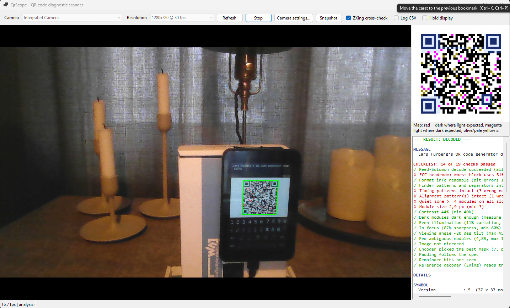

# QR code diagnostics scanner User Manual

QR code diagnostics scanner is a Windows desktop tool that does more than read a QR code: it **diagnoses** it. Point a camera at a QR code (for example one shown on a small embedded display) and QR code diagnostics scanner tells you what the code says, how it is built (version, ECC level, mask), how healthy it is (damage, quiet zone, error-correction headroom) and how good the optical conditions are (module size, contrast, blur, tilt, lighting).

It is meant for testing a QR code under real-world conditions: different distances, ambient lighting and viewing angles.



---

## 1. Requirements

| Item | Requirement |
|---|---|
| OS | Windows 10 or 11 |
| Runtime | .NET 8 SDK (to build) or .NET 8 Desktop Runtime (to run a published build) |
| Camera | Any webcam or USB camera that exposes a DirectShow driver |
| NuGet packages | `AForge.Video.DirectShow` (camera access) and `ZXing.Net` (reference decoder), restored automatically |

## 2. Building and starting

1. Put these files in one folder: `QrScope.csproj`, `Program.cs`, `QrCore.cs`, `Analyzer.cs`, `MainForm.cs`.
2. Open a terminal in that folder and run:

   ```
   dotnet run
   ```

   or `dotnet publish -c Release` to produce an executable.
3. The first build needs internet access to restore the NuGet packages.

---

## 3. The window

```
+--------------------------------------------------------------------------+
| Camera [..........] Resolution [......] Refresh Start Camera settings... |
| Snapshot  [x] ZXing cross-check  [ ] Log CSV  [ ] Hold display           |
+-----------------------------------+--------------------------------------+
|                                   |  QR module map (square)              |
|        Live camera view           |                                      |
|        with overlay               +--------------------------------------+
|                                   |  Message, checklist, details         |
|                                   |  (colored report)                    |
+-----------------------------------+--------------------------------------+
| status bar: fps | analysis ms | located % | decoded % | live state         |
+--------------------------------------------------------------------------+
```

### 3.1 Toolbar

| Control | What it does |
|---|---|
| **Camera** | Lists all cameras found. Choose one before pressing Start. |
| **Resolution** | Lists the modes the camera offers. The default is the largest mode up to 1920x1080. Higher resolution gives more pixels per QR module (better for distance) but slower analysis. |
| **Refresh** | Rescans for cameras (use after plugging one in). |
| **Start / Stop** | Starts or stops the camera. Camera and resolution can only be changed while stopped. |
| **Camera settings...** | Opens the camera driver's own dialog (focus, exposure, brightness, white balance, and so on). Use it to switch off auto-exposure or auto-focus, or to lock them for repeatable tests. Not every driver provides one. |
| **Snapshot** | Saves the current raw frame and the full report (see section 8). |
| **ZXing cross-check** | When ticked, every frame is also given to the independent ZXing decoder. It shows whether a typical third-party scanner can read the frame. Untick it to speed up analysis. |
| **Log CSV** | While ticked, writes one measurement row about every 200 ms to a CSV file (see section 7). |
| **Hold display** | Freezes the map and the report so you can read them. Analysis, the live overlay and logging keep running. |

### 3.2 Live camera view

QR code diagnostics scanner draws on top of the live image:

| Overlay | Meaning |
|---|---|
| **Green outline** | A QR code was located and decoded. |
| **Orange outline** | A QR code was located but could not be decoded. |
| **Cyan circles** | The three finder patterns (the big corner squares). |
| **Red dots** | Individual modules that differ from the ideal symbol (damage). They only appear when the symbol's content could be reconstructed, or for function patterns when it could not. |

### 3.3 QR module map (top right)

A square picture of the QR code exactly as the program sampled it. A quiet-zone margin is drawn around it.

| Color | Meaning |
|---|---|
| Black / white | Normal data modules read correctly. |
| Dark blue / pale blue | Function-pattern modules (finders, timing, alignment, format and version info) read correctly. |
| **Red** | A dark module where the ideal symbol has a light one. |
| **Magenta** | A light module where the ideal symbol has a dark one. |
| Olive / pale yellow | Marginal modules: the brightness was too close to the decision threshold to be trusted. These are modules that may flip with a small change in lighting. |

The map is useful for seeing *where* the problems are: a red/magenta cluster in one corner suggests glare or a reflection there, scattered yellow suggests low contrast or blur everywhere.

### 3.4 Report (bottom right)

The report is colored and has three parts, in this order:

1. **Result line**: `DECODED` (green) or `LOCATED BUT NOT DECODABLE` (red).
2. **MESSAGE**: the decoded text. Line breaks inside the message are shown as `\n`. If QR code diagnostics scanner's own decoder fails but ZXing manages to read the frame, ZXing's text is shown and labeled as such.
3. **CHECKLIST**: a green tick or a red cross per check, headed by "N of M checks passed" (green if everything passes, red otherwise). Section 5 explains every check.
4. **DETAILS**: the full measurements (section 6).

The report updates about five times per second. It keeps the last result visible when the QR code leaves the view. Your scroll position is preserved between updates.

### 3.5 Status bar

`fps | analysis ms | located % | decoded % (last N frames) | live state`

- **fps**: frames per second being processed.
- **analysis ms**: time spent analysing the last frame.
- **located %** and **decoded %**: share of the last 60 frames in which a QR code was found, and in which it was decoded. This is the most useful number for judging real-world robustness: a code that decodes in 100% of frames is much safer than one that flickers between 40% and 80%.
- **live state**: `decoded`, `located, NOT decodable`, or `no QR in view`. `| logging` is appended while CSV logging is on.

---

## 4. Typical workflow

1. Select the camera and resolution, then press **Start**.
2. Open **Camera settings...** and, if you want repeatable results, lock focus and exposure.
3. Show the QR code to the camera. Keep the whole code and some empty space around it inside the frame.
4. Read the MESSAGE and the CHECKLIST. Fix red crosses, then test again.
5. For a measurement series, tick **Log CSV** and vary one condition at a time (section 9).
6. Use **Hold display** to study a result, and **Snapshot** to keep it.

---

## 5. The checklist

A check passes (green tick) or fails (red cross). Checks that do not apply to the current code are left out, so the total number of checks varies.

### Decoding

| Check | Passes when |
|---|---|
| Reed-Solomon decode | Every error-correction block could be corrected. Fails if damage exceeds what the ECC can repair, or if the geometry was misjudged. |
| ECC headroom | The worst block uses **less than 50%** of its correction budget. A code that decodes only by consuming most of its ECC has little margin left for real-world degradation. |
| Format info readable | The format information (ECC level and mask) could be read with at most 3 bit errors from at least one of its two copies. Otherwise QR code diagnostics scanner tries all 32 ECC/mask combinations ("brute force"). |
| Version info readable | Versions 7 and above only: at least one of the two version-info copies has at most 3 bit errors. |

### Symbol structure (compared against an ideal re-rendered symbol)

| Check | Passes when |
|---|---|
| Finder patterns and separators intact | 0 wrong modules |
| Timing patterns intact | 0 wrong modules |
| Alignment pattern(s) intact | 0 wrong modules (versions 2 and above) |

### Optical conditions

| Check | Passes when |
|---|---|
| Quiet zone | At least **4 modules** of clean border on all four sides. If the frame edge cuts the quiet zone off, the measured value is shown and the report says so. |
| Module size | At least **3 px** per module in the camera image. |
| Contrast | At least **40%** between dark and light modules. |
| Dark modules dark enough | Dark modules measure no more than **110/255** (otherwise glare, backlight bleed or too much exposure). Shown for normal dark-on-light codes only. |
| Even illumination | Light level varies by no more than **25%** across the symbol. |
| In focus | Sharpness at least **60%**. Only checked when a clean in-frame quiet zone is available as reference. |
| Viewing angle | Tilt no more than **45 degrees**. |
| Few ambiguous modules | No more than **10%** of modules have a low contrast margin. |
| Image not mirrored | The symbol is not mirrored (as seen by some selfie-style cameras). It is still decoded when mirrored, but this is flagged. |

### Encoder conformance (only when decoded)

These checks are about how the QR code was *generated*, which is handy when you are testing your own QR encoder.

| Check | Passes when |
|---|---|
| Best mask | The encoder chose the mask pattern with the lowest penalty score, as the specification recommends. |
| Padding | The data ends with a terminator and alternating `0xEC` / `0x11` pad bytes (or fills the capacity exactly). |
| Remainder bits | The unused bits at the end of the symbol are zero. |

A failure here does not stop scanners from reading the code. It only means the encoder deviates from the specification.

### Reference decoder

| Check | Passes when |
|---|---|
| ZXing reads this frame | The independent ZXing decoder also decoded the frame. If QR code diagnostics scanner decodes but ZXing does not, a typical phone scanner may have trouble with detection or geometry even though the data is recoverable. Only present when **ZXing cross-check** is ticked. |

---

## 6. The details section

### Symbol
Version and size in modules, ECC level (L, M, Q or H, with the approximate share of codewords it can restore), mask pattern number and its formula, bit errors found in both copies of the format and version information, whether the image is mirrored, polarity (dark-on-light or inverted), and whether the alignment pattern was found (improves accuracy under perspective).

### Content
Message length, the encoding segments used (numeric, alphanumeric, byte, kanji, ECI and so on), how much of the data capacity is used, and the padding status. Kanji segments are recognised but not converted to text.

### Error correction
One line per Reed-Solomon block: its size, how many codewords had to be corrected, the maximum the block can correct, and the percentage of that budget used.

### Damage map
Modules that differ from the ideal symbol, counted per area: finder, separator, timing, alignment, format info, version info, dark module, data/EC area, remainder bits, with a total and a count of marginal modules.

When the code could not be decoded, the data area cannot be compared, so only the function patterns are evaluated.

### Quiet zone
Measured clean border, in modules, on each side of the symbol (top, right, bottom, left, relative to the symbol itself and not the screen). Values are capped at ">= 6". A side that touches the frame edge is marked as not verified. A dark bezel around a small display is a common cause of failure.

### Geometry / optics
- **Module size** in camera pixels and the symbol's width in pixels.
- **Rotation** of the symbol in the image.
- **Tilt**: approximate angle between the camera axis and the symbol's surface, derived from how much the symbol is foreshortened.
- **Keystone**: ratio of top to bottom edge and left to right edge (1.00 means no perspective distortion).
- **Axis shear**: how far the symbol axes are from being square.

### Image quality
- **Contrast**, with the average dark and light levels (0 to 255).
- **Finder contrast** at the three corners.
- **Illumination**: variation of the light level across the symbol.
- **Sharpness**: how well one-module features are resolved compared with solid areas (100% = crisp). Needs a clean quiet zone in the frame.
- **Clipped light**: share of light modules at 250/255 or more (overexposure).

### Mask penalty
The penalty score of all 8 mask patterns for this symbol. The used mask is marked with `*`. The lowest score is the best choice according to the specification.

### Reference decoder
What ZXing returned for the frame, plus a note when its text differs from QR code diagnostics scanner's or when only one of the two decoders succeeded.

---

## 7. CSV logging

Tick **Log CSV** to start a new file `Documents\QrScope\session_YYYYMMDD_HHMMSS.csv`. A row is written about every 200 ms while a QR code is located. Untick to close the file. The file path is shown in the status bar when logging starts.

| Column | Meaning |
|---|---|
| `time` | Time of day of the measurement |
| `decoded` | 1 if decoded, 0 if only located |
| `version`, `ecc`, `mask` | Symbol parameters (`?` / -1 if unknown) |
| `cw_errors` | Codewords corrected in total |
| `worst_block_pct` | Share of the ECC budget used by the worst block (above 100 means a block failed) |
| `damaged_modules` | Modules that differ from the ideal symbol |
| `marginal_modules` | Low-margin modules |
| `module_px` | Module size in camera pixels |
| `tilt_deg`, `rotation_deg` | Geometry |
| `contrast_pct` | Dark/light contrast |
| `sharp_pct` | Sharpness (empty value or -1 if not measurable) |
| `quiet_min` | Tightest quiet zone in modules |
| `inverted`, `mirrored` | 1 or 0 |
| `zxing_ok` | 1 or 0 when the ZXing cross-check is on, empty otherwise |
| `analysis_ms` | Analysis time of the frame |

The file opens directly in Excel or any plotting tool.

---

## 8. Snapshots

**Snapshot** saves two files to `Documents\QrScope`:

- `snap_YYYYMMDD_HHMMSS.png`: the raw camera frame, without overlay.
- `snap_YYYYMMDD_HHMMSS.txt`: the complete report of that frame.

---

## 9. Testing a QR code on an embedded display

Change **one variable at a time**, keep the others fixed, and log each series.

### Distance
Start close and move back in steps (for example 10 cm). Note the distance at which `module_px` falls below about 3 and where "decoded %" starts to drop. The ECC headroom check shows how close to failure you are before decoding actually fails. A higher camera resolution extends the usable distance.

### Viewing angle
Tilt the display in steps (for example 15, 30, 45, 60 degrees) and watch tilt, keystone and decoded %. LCD and OLED panels also lose contrast at steep angles, which shows up in the contrast and dark-level checks.

### Lighting
Test in dark, normal indoor, bright indoor and daylight conditions, and with a lamp causing glare on the screen. Red or magenta clusters on the map and a failing "dark modules dark enough" check indicate glare. Lock the camera exposure first, otherwise auto-exposure hides the differences.

### Display-specific tips
- **Quiet zone**: a dark bezel or a screen border right next to the code is a very common reason for failure. Leave at least 4 modules of white around the code on the display itself.
- **Module size on the display**: use whole-pixel module sizes (for example exactly 4x4 or 5x5 display pixels per module). Non-integer scaling blurs module edges and lowers the sharpness figure.
- **Flicker and banding**: multiplexed or PWM-dimmed backlights can produce moving bands in the camera image. A longer exposure or a different camera frame rate often helps.
- **Moire**: if you see interference patterns between the display pixels and the camera sensor, change the distance slightly or the code's scale.
- **Polarity**: a light-on-dark (inverted) code is detected and decoded, but many phone scanners cannot read inverted codes. Prefer dark modules on a light background.
- **Version and ECC choice**: a smaller version means bigger modules for a given display size. A higher ECC level improves robustness but may force a larger version. The "Data capacity" line and the ECC headroom check help you pick.

---

## 10. Troubleshooting

| Problem | What to try |
|---|---|
| "No cameras found" | Check the camera is connected and not blocked by Windows privacy settings (Settings > Privacy > Camera), then press **Refresh**. |
| Camera does not start | Another program may be using it. Close it and try again. Try a lower resolution. |
| Image is dark or flickers | Use **Camera settings...** to adjust or lock exposure. |
| Analysis is slow, low fps | Choose a lower resolution, or untick **ZXing cross-check**. |
| Orange outline, never decodes | Look at the checklist and map: usually blur (focus), glare, too few pixels per module, or a missing quiet zone. |
| "No QR in view" although a code is visible | Make sure the whole code plus some margin is in frame, that the camera is focused, and that the three corner squares are clearly visible and not heavily distorted. |
| QR code diagnostics scanner decodes but ZXing does not | Detection or geometry is marginal. Improve focus, size and quiet zone. |
| Frequent "Format info unreadable" | Usually severe blur or very low contrast around the corner squares. |
| Report jumps around too fast to read | Tick **Hold display**. |
| Build error about `AForge` or `NU1701` | The warning is expected on .NET 8 and is suppressed in the project. If packages fail to restore, check your internet connection and NuGet source. |

---

## 11. Limits and notes

- Only standard QR Code (Model 2, versions 1 to 40) is supported. Micro QR and other barcode types are not.
- One QR code is analysed at a time: the best-matching group of three finder patterns in the frame. With several codes in view, only the most plausible one is reported.
- Tilt, keystone and sharpness are estimates from a single camera frame. Use them for comparing conditions against each other rather than as absolute measurements.
- The thresholds used by the checklist (50% ECC budget, 3 px module size, 40% contrast, 45 degrees tilt, and so on) are reasonable engineering defaults, not requirements of the QR standard. The quiet zone of 4 modules and the mask-selection and padding rules are from the standard (ISO/IEC 18004). To change a threshold, edit the checklist section at the end of `Deep()` in `Analyzer.cs`.
- QR code diagnostics scanner does not transmit anything over the network. Frames are processed in memory, and files are only written when you use Snapshot or CSV logging.
